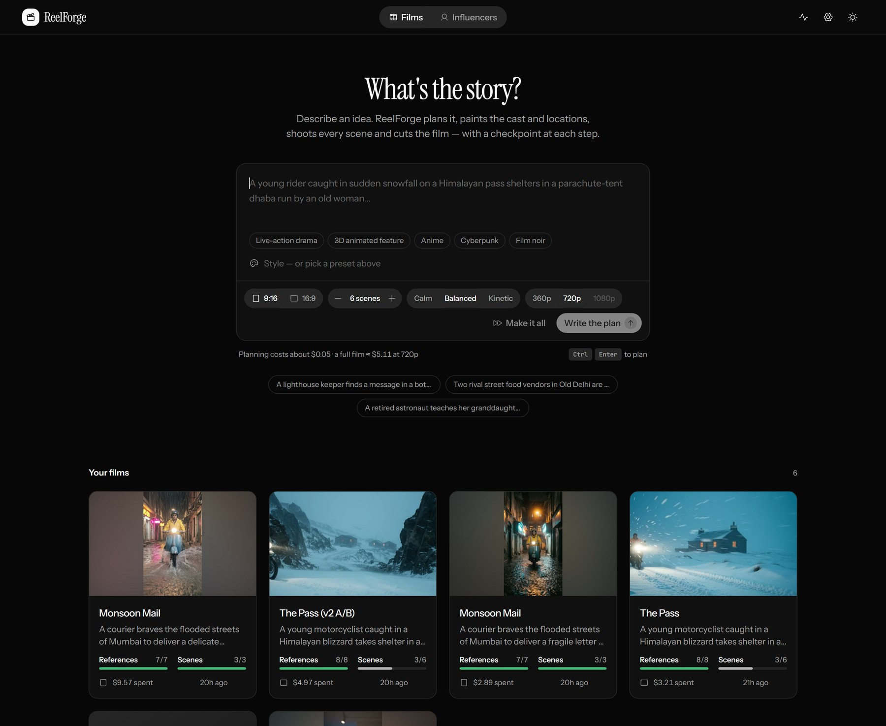
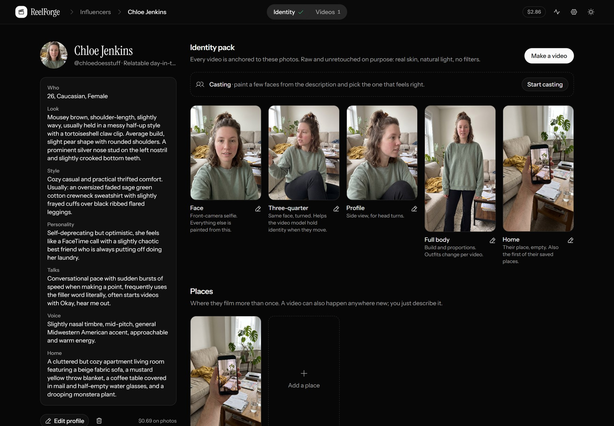
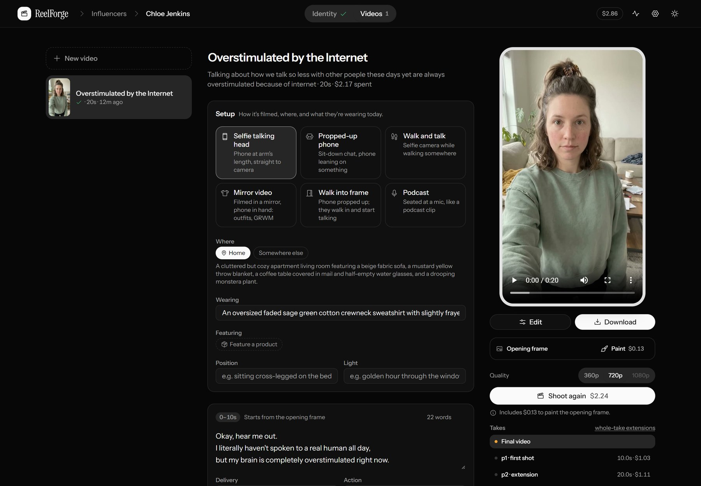
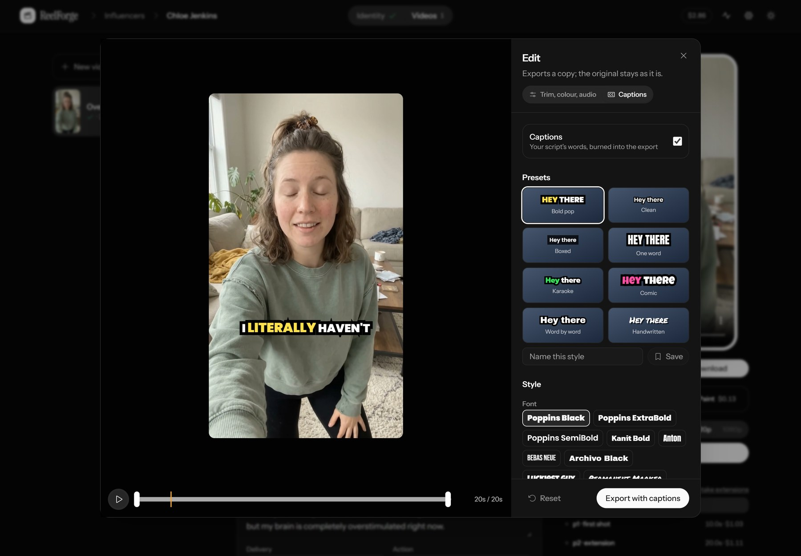
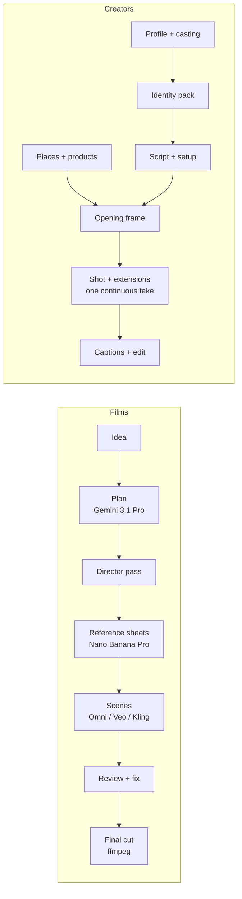

# ReelForge

**An AI video studio that plans, casts, shoots and edits short films and creator videos, with characters that stay the same person in every shot.**

Type an idea and ReelForge writes a production plan, paints the cast and locations, shoots every scene with those references attached, and cuts the film. Or design a creator once (their face, personality, voice, the places they film) and make selfie vlogs, mirror try-ons, walk-and-talks and product reviews where they always look and sound like themselves, with captions that are exactly the script.

It runs locally: a Python engine over Google's generative models (Gemini 3.1 Pro, Nano Banana Pro, Gemini Omni Flash, Veo 3.1), ffmpeg for the edit, and a Next.js interface.

  
  

  
  

## What it does

**Films**: idea → plan with timed beats → a director pass → reference sheets → scenes → final cut
- Style presets (live action, 3D animated, anime, cyberpunk, noir) and pacing (calm, balanced, kinetic).
- Every scene is shot with its character, prop and location references attached; continuous scenes start from the previous shot's last frame.
- Pick a model per scene (Gemini Omni, Veo 3.1, Kling), fix a take with a sentence ("heavier snow") instead of re-rolling it, or have an AI reviewer score it.
- A character library: save a character from one film and cast them in the next.

**Creators**: design → casting → identity → places and products → videos → captions
- Design from a concept, a **mood board** (read into words for the type, never copying a face), or consented photos of a real person.
- **Casting**: paint a few faces, refine one with notes, lock it. An identity pack (face, three-quarter, profile, full body) anchors every video.
- Six camera formats: selfie, propped-up phone, walk and talk, mirror, walk into frame, podcast. Each video picks its own place, outfit, position and light.
- **Products from photos**: the exact top or lipstick, worn or held. The script uses only the facts you give it.
- Videos are one continuous take of up to 40 s: a painted opening frame, then extended 10 s at a time so the face, voice, room and camera never cut.
- **Captions that are exactly the script**, timed to the voice, styled and burned in, with presets, animations and any Google font.

## How it works

A few decisions that make the difference:

- **Consistency without fine-tuning.** Nothing is trained per character. Identity comes from painted reference images passed to the video model on every shot, and each reference image is labelled by position in the prompt, so the model knows which image is the person, the place or the product. Creator videos start from an opening frame painted from those references, then grow as a single take, so there is no cut for the face to drift across.
- **A director that stages around what video models get wrong**, learned from the R&D below: objects are in hand from the first frame, hand-offs happen across an edit instead of in close-up, vehicles travel straight.
- **A provider layer.** Each model is an adapter (prompt syntax, submit, collect, price) talking to that company's own API. The job id is logged before waiting, so a paid clip is never lost to a crash.
- **Captions you can trust.** The AI never writes caption text; it only returns when each numbered script word is spoken, and flags where the delivery differs from the script. The live preview uses the same colour maths and corrected font metrics as the libass export, so what you see is what you get.
- **Cost-aware by design.** Every call is logged with an estimated cost, every button that spends money shows its price, and anything over $1 asks first. The tracker came within about 10-15% of the real Google Cloud bill.
- **Guardrails.** Characters from real photos require a consent statement; mood boards never pass a face to the image or video models; uploads are re-encoded with EXIF and location stripped.
- **Tested offline.** 150+ tests run against fakes of every API, and a demo mode runs the whole interface with a fake model, so nothing is billed while building.

## What I learned about AI video

I ran controlled rounds (same scenes, two takes each, every take scored 1-5 by an AI reviewer against the plan) before deciding how the planner and director should work. The full log is in [docs/RND.md](docs/RND.md).

| Round | Question | Result |
|---|---|---|
| Baseline | Where do takes fail? | Frozen starts, morphing on 3D motion toward camera, garbled text, and style words that turn into artefacts ("anamorphic" became a static lens flare) |
| A/B 1 | Do timed beats and a director pass help? | Yes: mean 4.22 vs 3.85; physics 2.5 to 3.3; usable-or-fixable takes 1/6 to 3/6 |
| A/B 2 | Fresh plans, cuts inside a clip | Cuts inside a clip made costumes drift (4.67 to 2.83); a close-up hand-off merged fingers into the envelope, so hand-offs are now implied across an edit |
| Check | Did the fixes hold? | The targeted failures were gone, but objects "materialised" mid-shot, so now every object a character uses is visible from the first frame and positions are stated |
| Models | Omni vs Veo 3.1 Fast at 720p | Omni 3.48 vs Veo 3.23: Veo holds faces slightly better but follows direction worse; 720p didn't fix morphing; wheels and hands fail in every model tried |

The takeaway: prompt changes fix the failures they target, but current models have a floor on vehicles, hands and small objects. The better lever is staging around them, which is what the director does.

## What it costs

| | Price |
|---|---|
| A reference image or opening frame (Nano Banana Pro, 2K) | $0.13 |
| Video, Gemini Omni | 360p $0.034/s · 720p $0.101/s · 1080p $0.152/s |
| A 30 s creator video at 720p, including its opening frame | ~$3.40 |
| Casting four faces | ~$0.54 |
| Syncing captions to the voice | ~$0.02 |

An Omni extension returns the whole take but bills output only for its new seconds (measured on a live run), which is what makes 30-40 s continuous takes affordable.

## Built with

Python · FastAPI · google-genai on Vertex AI (Gemini 3.1 Pro, Nano Banana Pro, Gemini Omni Flash, Veo 3.1) · Kling API · ffmpeg and libass · Next.js 16 (static export) · Tailwind CSS v4 · Radix · SWR · Motion · Phosphor icons

About 7,000 lines of Python and 8,000 of TypeScript, with 150+ offline tests.

## Run it

Windows: double-click **`ReelForge.bat`**. Anywhere else: `python launch.py`. Try it without any account or cost:

    python launch.py --demo

Needs Python 3.11+, Node.js and ffmpeg. For real generation, put Google Cloud (Vertex AI) or Gemini API credentials in `.env`. Setup, every feature, the code map and tests are in the **[guide](docs/GUIDE.md)**.

## Status

A personal, local, single-user tool that I use to make videos. Next: voice matching through speech-to-speech conversion, and a hosted version.
